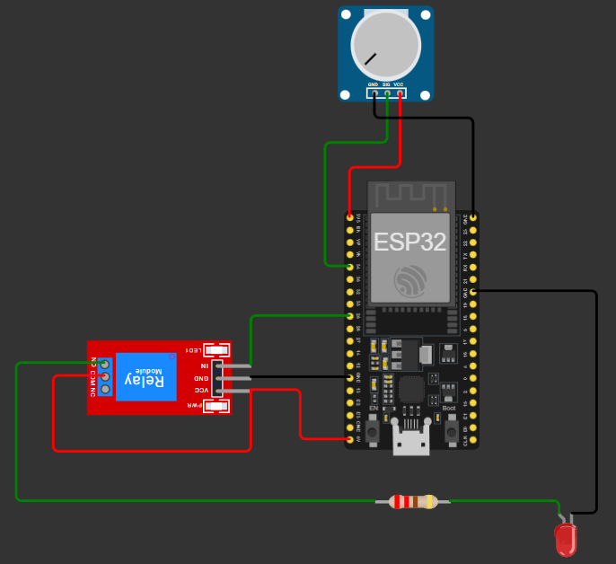

# Sistema de Riego Automatizado IoT - Olivar (Santa Cruz de Mudela)

Prototipo virtual (Nivel de madurez TRL 4) desarrollado para la optimización del recurso hídrico en cultivos de olivar, empleando la iniciativa CDIO y control automático en lazo cerrado.

## 🛠️ Arquitectura de Hardware y Mapeo de Pines (GPIO)
El circuito se encuentra implementado en la plataforma de simulación Wokwi bajo la siguiente distribución:

| Componente | Pin del Componente | Pin del ESP32 | Tipo de Señal / Función |
| :--- | :--- | :--- | :--- |
| Sensor Capacitivo (%VWC) | AOUT (Salida Analógica) | **GPIO 34** (ADC1_CH6) | Lectura analógica de humedad |
| Módulo Relé (Electroválvula) | IN (Control Digital) | **GPIO 25** | Salida digital de conmutación (ON/OFF) |
| Indicador de Activación | Anodo / LED en serie | GPIO 4 / Salida | Visualización física del cierre de potencia |

---

## 📷 Evidencia del Circuito Virtual en Wokwi
A continuación se muestra el esquema de conexiones y la integración física de los componentes electrónicos virtuales:

*Nota.* Diagrama físico del circuito armado en la plataforma Wokwi. Muestra la integración del microcontrolador ESP32 con la lectura analógica del sensor capacitivo (emulado con potenciómetro en GPIO 34), el puente de alimentación de 5V entre los bornes VCC y COM del relé, el pin de control digital en GPIO 25 y el indicador visual LED de activación de riego. Elaboración propia a partir de la simulación del proyecto.# sistema-riego-olivar-iot
